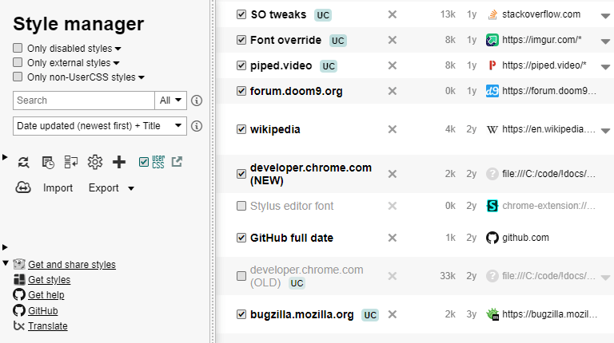
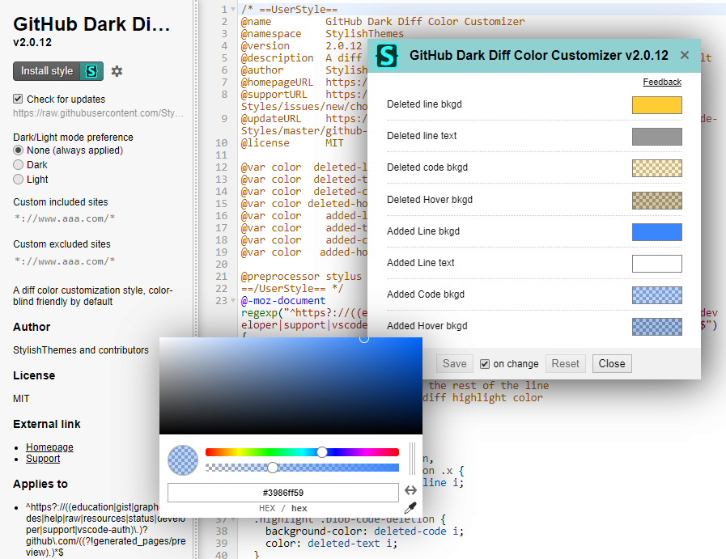
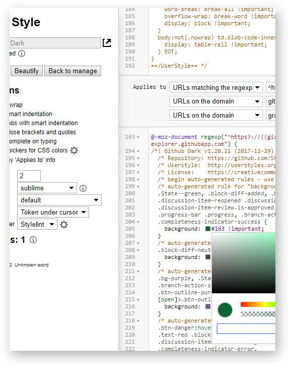
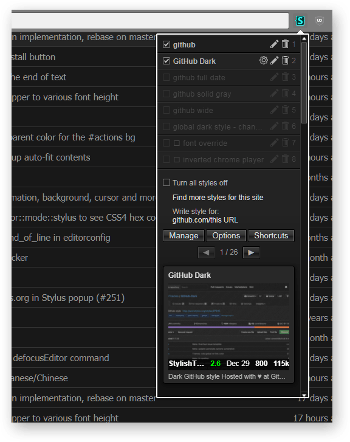
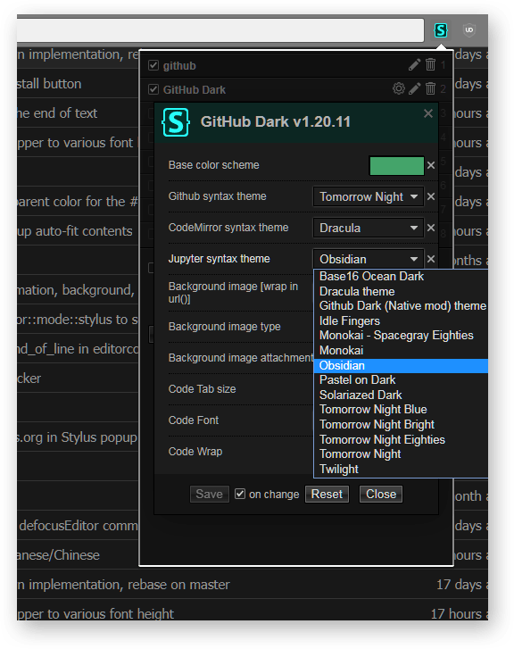
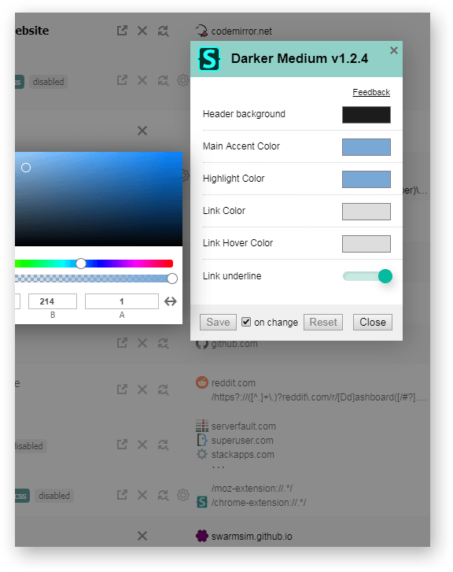
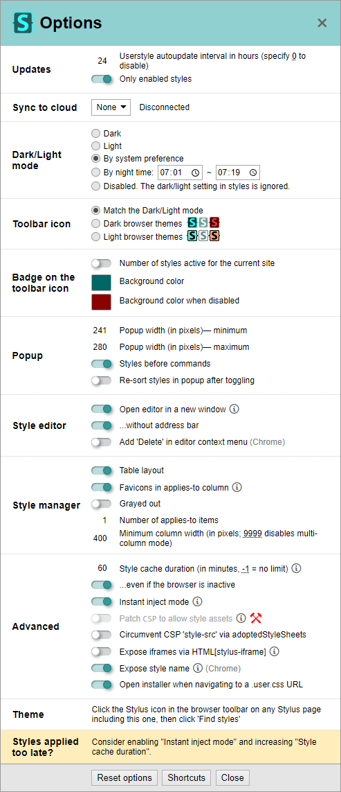

# Zovo Themer

Zovo Themer is a no-code visual theming layer for Chrome. Pick an element on a
page to create a scoped rule, tune site-wide color, type and corner controls,
apply per-domain reading presets, then export the result as portable
`.user.css`.

The Chrome MV3 build keeps the mature upstream style engine and adds an
independent visual workflow, UI, artwork, storage namespace, runtime namespace,
licensing boundary and build artifact namespace.

## Build and test

Use Node.js 24 or newer and pnpm 11.8.0:

```sh
pnpm install
SUPABASE_ANON_KEY=sb_publishable_your_key pnpm build-chrome-mv3
pnpm test
```

The production MV3 build deliberately fails when the publishable Supabase key
is absent or malformed. See [BUILD.md](./BUILD.md) for the complete procedure.
The publishable key is a client identifier, not a privileged server credential.

## Privacy and source

Site profiles, picked selectors and the license cache are stored locally.
The extension makes no analytics or advertising requests. It contacts the
license verifier only after explicit activation and sends the entered key plus
the product identifier. See [privacy-policy.md](./privacy-policy.md).

This complete modified source is licensed under GPL-3.0-only. Changes from the
upstream base are recorded in [CHANGES.md](./CHANGES.md); upstream copyright
notices and file headers are preserved.

The Free/Pro distinction is a product configuration, not technical
anti-circumvention. GPL recipients may inspect, modify, rebuild and redistribute
the complete corresponding source under GPL-3.0, including builds with a
different or removed feature boundary.

## Upstream project history

The project is based on the upstream openstyles/stylus codebase. The historical
README follows so the original feature, contributor and licensing context stays
available.

Stylus is a browser extension to restyle the websites via CSS themes, compatible with Chrome, Firefox, and any Chromium-based browsers.

## Highlights

* No analytics/tracking - this is our foundational principle as Stylus was created solely because the original Stylish extension was sold to a Web analytics company.
* Lots of themes in external galleries like [USW](https://userstyles.world/explore), [USO archive](https://uso.kkx.one/browse/categories), [greasyfork](https://greasyfork.org/en/scripts/by-site/*?language=css):
  * click the `Find` button in the popup UI,
  * click the screenshot to apply the style to the website,
  * click the screenshot again to uninstall the style.
* [UserCSS](https://github.com/openstyles/stylus/wiki/Usercss) styles with advanced customization installable from any raw plain text URL.
* Cloud sync for Dropbox, GDrive, OneDrive, or any WebDAV-compatible server.
* Backup to a JSON file compatible with other userstyles managers.
* Auto-update for styles, configurable in each style and globally in the options.
* Lightweight content script (~10kB) in the web pages runs in about a millisecond.
* Lots of options to configure UI and behavior.
* Built-in editor for your own CSS themes (CSS/LESS/Stylus) that highlights problems using up-to-date linters ([Stylelint](https://stylelint.io/) and [CSSLint-mod](https://github.com/openstyles/csslint-mod)) with customizable rules.
* Support for external IDE or advanced editor via the [live reload feature](https://github.com/openstyles/stylus/wiki/Writing-UserCSS#live-reload-on-the-fly-previewingwhen-developing-styles-locally-in-another-editoride) e.g. you can write SASS/SCSS by setting up a build step to produce standard CSS in a separate file that will be tracked by Stylus.

<details><summary>

## Screenshots

</summary>

* Manager

   

* Installer

  

* Editor

  

* Popup search

  

* Popup config

  

* Manager config

  

* Options

  

</details>

## Releases

1. [Chrome Web Store](https://chromewebstore.google.com/detail/stylus/clngdbkpkpeebahjckkjfobafhncgmne) or [beta](https://chromewebstore.google.com/detail/stylus-beta/apmmpaebfobifelkijhaljbmpcgbjbdo)<br>for modern Chrome (v128+) and Chromium-based browsers like Brave, Opera, Vivaldi.

2. [Mozilla addons](https://addons.mozilla.org/firefox/addon/styl-us/) or [beta](https://github.com/openstyles/stylus/releases) (as an xpi file)<br>for Firefox and any Gecko-based browser.

3. [Zip file](https://github.com/openstyles/stylus/releases) with `-mv2` suffix to _load as an unpacked extension_<br>for older Chromium-based browsers which only support ManifestV2 version.

## Pre-release test builds (nightlies) [](https://github.com/openstyles/stylus/actions/workflows/ci.yml)

1. click a workflow entry in https://github.com/openstyles/stylus/actions/workflows/ci.yml,
2. download the file in `Artifacts` - this requires a github.com account,
3. install it, see [the instruction](https://github.com/openstyles/stylus/wiki/Install-Stylus-from-GitHub).

## Asking questions, participating, contributing

* Bugs, discussions, questions, ideas, pull requests: https://github.com/openstyles/stylus
* Wiki for many common tasks and questions: https://github.com/openstyles/stylus/wiki
* Discord: https://discordapp.com/widget?id=379521691774353408 
* Helping with translation: https://explore.transifex.com/github-7/Stylus/
* Guidelines and more info: https://github.com/openstyles/stylus/CONTRIBUTING.md

## License: [GPLv3](./LICENSE)

* Copyright &copy; 2017-2025 [Stylus Team](https://github.com/openstyles/stylus/graphs/contributors)
* Copyright &copy; 2005-2014 [Jason Barnabe](jason.barnabe@gmail.com) for the ever diminishing parts of the original [Stylish](https://github.com/stylish-userstyles/stylish/).
* Licenses of modified external libraries: [vendor-overwrites](./src/vendor-overwrites).
